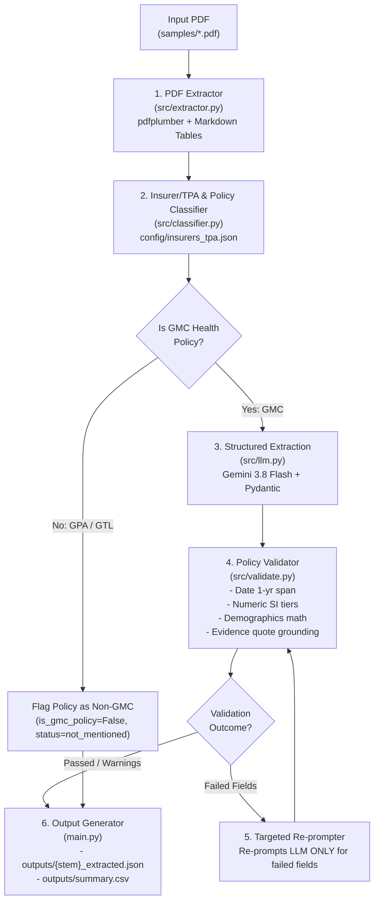

# GMC Insurance Policy Intelligence Extractor

An intelligent, production-ready Python CLI that extracts structured data from Indian **Group Medical Cover (GMC)** insurance policy certificates and schedules into standardized JSON and CSV formats. Designed to integrate directly with internal **Quality Management Systems (QMS)**.

Built with Python, `pdfplumber`, Pydantic v2, and Google's `google-genai` SDK (`gemini-3.7-flash`).

---

## 1. Project Overview

Group Medical Cover (GMC) policy documents exhibit extreme variations across carriers:
- Formats range from single-schedule summaries to multi-page certificates with tabular annexures.
- Nomenclature varies widely (e.g., *"Normal Delivery"* vs *"Maternity Limit"*, *"Pre-existing illness covered from Day 1"* vs *"PED 48 months waived"*).
- Policies often contain complex sub-limits, percentage capping, waiting period waivers, and corporate buffer rules.
- Documents submitted for processing may include non-health policies, such as **Group Personal Accident (GPA)**, which must be detected and flagged rather than forced into GMC medical fields.

This solution implements a **hybrid document intelligence pipeline**:
1. **Layout-aware text & table extraction**: Reads page-by-page text and converts tables into clean Markdown grids using `pdfplumber`.
2. **Regex-driven pre-scanning**: Discovers insurer and TPA hints from `config/insurers_tpa.json` and classifies whether the document is GMC or Non-GMC (e.g. GPA).
3. **Structured GenAI extraction**: Calls Gemini via the official `google-genai` SDK with strict JSON Schema constraints against Pydantic models.
4. **Rule-based validation & targeted self-correction**: Audits policy dates (~1-year span), Sum Insured tiers (positive numbers), member counts arithmetic (`total_lives == employees + dependents`), and verbatim quote grounding against source text, re-prompting the LLM *only* for failing fields.

---

## 2. Architecture & Flow



---

## 3. Technologies Used & Rationale

| Technology | Purpose | Rationale |
|---|---|---|
| **Python 3.10+** | Core Language | Standard for document processing, data science, and AI agent engineering. |
| **`pdfplumber`** | PDF Text & Table Extraction | Robust coordinate-based extraction of tables and raw text; formats grid structures cleanly into Markdown without heavy OCR overhead. |
| **`google-genai` SDK** | LLM Structured Output | Current Google GenAI SDK (`google-genai >= 2.3.0`) with native `types.GenerateContentConfig(response_schema=...)` for strict Pydantic compliance. |
| **`gemini-3.7-flash`** | Reasoning & Mapping Engine | High reasoning accuracy for contractual clauses, 1M context window, fast latency, and strict adherence to structured schemas. |
| **Pydantic v2** | Data Schema & Serialization | Industry standard for type safety, validation, and JSON schema generation. |
| **`pytest`** | Automated Testing | Comprehensive unit and mock integration test suite. |
| **`python-dotenv`** | Configuration Management | Secure loading of `GEMINI_API_KEY` from `.env` without hardcoded secrets. |

---

## 4. Setup Instructions & Installation

### Prerequisites
- Python 3.10 to 3.14 installed
- A Google Gemini API key (obtainable from [Google AI Studio](https://aistudio.google.com/))

### Installation Steps

1. **Clone or navigate to the repository:**
   ```bash
   cd gmc-extractor
   ```

2. **Create and activate a virtual environment:**
   - **Windows:**
     ```powershell
     python -m venv .venv
     .\.venv\Scripts\activate
     ```
   - **Linux / macOS:**
     ```bash
     python3 -m venv .venv
     source .venv/bin/activate
     ```

3. **Install dependencies:**
   ```bash
   pip install -r requirements.txt
   ```

4. **Configure your API Key:**
   Copy the `.env.example` file to `.env`:
   ```bash
   copy .env.example .env    # Windows
   cp .env.example .env      # Linux/macOS
   ```
   Edit `.env` and set your key:
   ```env
   GEMINI_API_KEY=your_gemini_api_key_here
   GEMINI_MODEL=gemini-2.5-flash
   ```

---

## 5. How to Run the Project

### A. 🌐 Launch the Interactive Web Dashboard (Recommended)
Launch the modern glassmorphic web dashboard with live PDF drag-and-drop, 30-feature inspection, comparative matrix, and SVG visual analytics:

```bash
python run_ui.py
```
This automatically launches your browser at **`http://127.0.0.1:8000`** with:
- 📊 **Portfolio Analytics**: Aggregated lives, premium, cost per life, and interactive demographics donut chart.
- 🔍 **Policy Deep-Dive**: Complete 30-feature audit grid with real-time clause search, status filters (Covered, Waived, Applied), and verbatim quote grounding citations.
- ⚖️ **Side-by-Side Comparison Matrix**: Cross-policy benefit comparison table with CSV export.
- 📤 **Live PDF Ingestion**: Drag-and-drop upload zone that processes new policies directly through the Gemini pipeline in real-time.

---

### B. Batch Folder Processing (CLI)
Process all PDF policies in the `samples/` directory and save outputs to `outputs/`:
```bash
python main.py --input samples/ --output outputs/
```

### C. Single File Processing (CLI)
Process an individual policy PDF:
```bash
python main.py --input "samples/1.Policy Copy.pdf" --output outputs/
```

### D. Advanced CLI Options
```bash
python main.py --help
```
Options available:
- `--input PATH`: File or folder path (default: `samples/`).
- `--output PATH`: Directory to save extracted JSON and CSV (default: `outputs/`).
- `--model MODEL_NAME`: Override model (default: `gemini-3.5-flash-lite`).
- `--no-reprompt`: Disable the targeted secondary validation re-prompting pass.
- `--verbose`: Enable detailed debug tracing and error stacks.

---

## 6. Extraction Methodology & Prompt Strategy

### 1. Document Extraction & Markdown Table Formatting
`src/extractor.py` opens the PDF using `pdfplumber`. For every page:
- Tabular data is extracted via `.extract_tables()` and converted into clean GitHub-flavored Markdown tables:
  ```markdown
  | Policy No | POL-123456 |
  | --- | --- |
  | Sum Insured | Rs. 500,000 |
  ```
- Noisy reverse watermarks (e.g. `.noitaticilos fo rettam tcejbus eht` from Liberty policies) are identified and purged.
- Explicit page boundary tags (`--- PAGE X OF Y ---`) are injected to provide unambiguous grounding coordinates for the LLM.

### 2. Pre-Scan Classification & Hinting
`src/classifier.py` reads regex rules from `config/insurers_tpa.json`:
- **Insurers**: Identifies Care Health, Niva Bupa, Liberty General, Tata AIG, Star Health, ICICI Lombard, etc.
- **TPAs**: Identifies Medi Assist, Vidal Health, Paramount, Raksha, In-House Claims Servicing Teams, etc.
- **Policy Type Classification**: Checks for Group Personal Accident (GPA) and Group Term Life (GTL) signatures.
  - When a GPA policy is identified (e.g., `Net Catalyst - GPA` or `Policy liberty`), it sets `is_gmc_policy=False` and instructs the pipeline **not** to force or hallucinate medical hospitalization benefits.

### 3. Anti-Hallucination & Synonym Resolution
The system prompt enforces strict constraints:
- **Zero Hallucination Rule**: If a benefit is not explicitly stated in the document, status MUST be `not_mentioned`, and all limits, days, conditions, and evidence MUST be `null`.
- **Synonym Mapping**: Resolves insurance-specific synonyms to canonical schema names:
  - *Room Rent capping* $\rightarrow$ `room_rent`
  - *Intensive Care Unit / ICCU* $\rightarrow$ `icu_charges`
  - *Pre-hospitalization expenses* $\rightarrow$ `pre_hospitalization`
  - *PED 48 months waiver / Day 1 PED* $\rightarrow$ `pre_existing_diseases`
  - *Normal delivery sub-limit* $\rightarrow$ `maternity_normal`
  - *Corporate floater / buffer pool* $\rightarrow$ `corporate_buffer`

---

## 7. Rule-Based Validation & Targeted Re-prompting

`src/validate.py` executes 4 strict audits:

1. **Policy Tenure Check**:
   - Parses `start_date` and `end_date` across diverse Indian insurance formats (`DD-Mon-YYYY`, `DD/MM/YYYY`, `YYYY-MM-DD`).
   - Verifies the duration spans approximately 1 year ($350 \le \text{days} \le 375$).
2. **Sum Insured Tiers Check**:
   - Confirms all values in `sum_insured_tiers` are strictly positive numbers.
3. **Demographics Arithmetic Check**:
   - Audits that $\text{total\_lives} = \text{total\_employees} + \text{total\_dependents}$ (or sum of member breakdown). Flags arithmetic discrepancies.
4. **Evidence Grounding Verification**:
   - For every benefit where `evidence` is cited, normalizes punctuation/whitespace and verifies whether the substring exists in the document text on `source_page`.
   - If a quote cannot be verified, it is marked as `EVIDENCE_UNGROUNDED`.

### Targeted Self-Correction Re-prompting
If validation fails:
- The system isolates **only the failing fields** and their relevant page snippets.
- It builds a compact, targeted correction request.
- Gemini reviews the specific issue and either corrects the value with a verbatim quote or flips the status to `not_mentioned`.
- The record is re-audited and tagged as `PASSED`, `PASSED_WITH_WARNINGS`, or `FAILED`.

---

## 8. JSON Schema & QMS Mapping Logic

Every extracted feature adheres to one unified shape (`FeatureBenefit` in `src/schema.py`):

```json
{
  "status": "covered",
  "limit_amount": 50000.0,
  "limit_percent_si": 2.0,
  "days": 30,
  "conditions": "Normal room rent 2% SI per day",
  "source_page": 2,
  "evidence": "Maximum eligibility for Normal Hospitalization 2 % of Sum Insured per day",
  "confidence": 0.95
}
```

### Complete Field Hierarchy

```text
GMCPolicyExtraction
├── is_gmc_policy: bool
├── policy_type: str ("Group Medical Cover" | "Group Personal Accident" | ...)
├── flag_notes: str | null
├── insurer_name: str | null
├── tpa_name: str | null
├── policy_details
│   ├── policy_name, policy_number, policy_holder_name
│   ├── start_date, end_date, policy_tenure_days
│   ├── is_renewal, previous_policy_number
│   ├── family_structure
│   └── sum_insured_tiers: [float]
├── premium
│   ├── net_premium, gst_amount, total_premium, payment_frequency
├── demographics
│   ├── total_employees, total_spouses, total_children, total_parents, total_dependents, total_lives
├── features (All 28+ benefits use unified FeatureBenefit shape)
│   ├── room_rent, icu_charges, pre_hospitalization, post_hospitalization
│   ├── maternity_normal, maternity_c_section, maternity_waiting_period_9m
│   ├── baby_day_one_cover, vaccination_coverage
│   ├── waiting_period_30_days, waiting_period_first_second_year, pre_existing_diseases
│   ├── day_care_expenses, opd_benefit, teleconsultation, pharmacy_discount
│   ├── domiciliary_hospitalization, annual_health_checkup, modern_treatment
│   ├── bariatric_treatment, psychiatric_treatment, ayush_treatment
│   ├── lgbtq_live_in_partners, organ_donor_expenses
│   ├── infertility_treatment, surrogacy_treatment
│   ├── ambulance_charges, air_ambulance_charges
│   └── corporate_buffer, disease_wise_capping
├── source_file: str
├── total_pages: int
├── validation_status: "PASSED" | "PASSED_WITH_WARNINGS" | "FAILED"
└── validation_messages: [str]
```

---

## 9. Assumptions Made

1. **Annual Policy Baseline**: GMC health policies in corporate India are assumed to have a standard 1-year duration ($\approx 365$ days) unless multi-year or short-term endorsements are explicitly documented.
2. **Direct/In-House Claims**: When an insurer (such as Care Health) handles claims via its own dedicated servicing unit rather than an external TPA, the TPA is categorized as `"In-House / Direct Insurer Claims Team"`.
3. **Table Structure**: Multi-column benefit tables are extracted with row/column fidelity into Markdown grids to preserve associations between benefit tiers (e.g., SI tier vs Room Rent %).
4. **Verbatim Evidence**: A benefit is only considered grounded if a recognizable substring exists in the document text on or adjacent to the cited page.

---

## 10. Known Limitations

1. **Scanned/Image-Only PDFs**: The current implementation relies on text-based PDF extraction via `pdfplumber`. Pure raster scanned images without an embedded text layer would require an OCR pre-processing step (e.g., Tesseract or Gemini Vision multimodal input).
2. **Complex Embedded Addenda**: Policies referencing separate unattached master policy wordings (e.g. *"terms as per Annexure B"* where Annexure B is omitted from the file) will accurately report those benefits as `not_mentioned` because the addendum was not included in the PDF.
3. **Multi-Carrier Co-Insurance**: If a policy is co-insured by multiple carriers with unequal shares, only the primary lead insurer is captured in `insurer_name`.

---

## 11. Evaluation & Duplicate Handling

> [!NOTE]
> **Byte-Identical Duplicate Policies**: As verified by SHA-256 hash comparison (1cb6cb1abac746f16fe027dfcab26918dcb2a06ce094a8782df5244511e51918), Policy liberty 2022-2023.pdf and Net Catalyst - GPA - Policy Copy - 2022-23.pdf are bit-for-bit identical copies of the same Liberty Group Personal Accident schedule. The pipeline detects both as Group Personal Accident policies (is_gmc_policy=False), leaves medical benefits as 
ot_mentioned, and flags them accordingly.

---

## 12. Automated Test Suite

A comprehensive test suite with 22 unit and integration tests is included.

> [!IMPORTANT]
> **LLM Mocking in Tests**: All automated tests in 	ests/ mock the Gemini LLM via unittest.mock.MagicMock to ensure reliable, zero-cost, and offline-executable testing without requiring live API keys or incurring external API usage. Live end-to-end extractions are performed by executing python main.py with GEMINI_API_KEY configured.

Run tests using pytest:
`ash
pytest -v
`

### Test Coverage Highlights:
- 	ests/test_schema.py: Verifies Pydantic serialization, default 
ot_mentioned shapes, and presence of all 28+ benefits.
- 	ests/test_extractor.py: Tests Markdown table conversion, newline handling, and Liberty backwards watermark stripping on a live sample PDF.
- 	ests/test_classifier.py: Validates regex insurer and TPA detection and GPA vs GMC policy classification.
- 	ests/test_validate.py: Validates date parsing, 1-year duration bounds, member math, and evidence quote grounding checks.
- 	ests/test_mock_integration.py: End-to-end integration test of the extraction pipeline using a mocked Gemini client.
- 	ests/test_cli.py: Tests filename sanitization, CSV summary export, and non-zero exit code error handling on failure.

---

## 13. License

Internal Technical Assessment / Proprietary.
